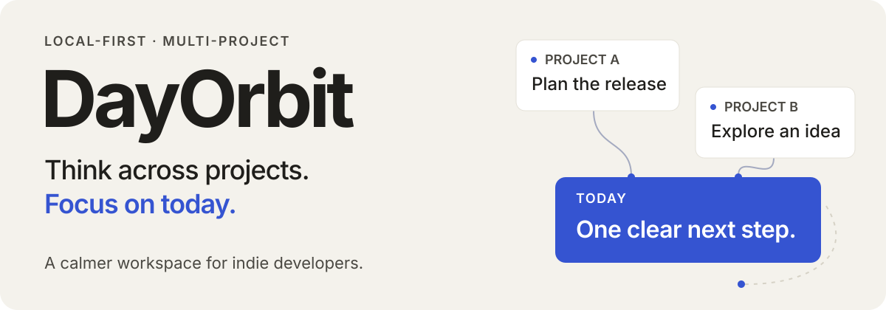
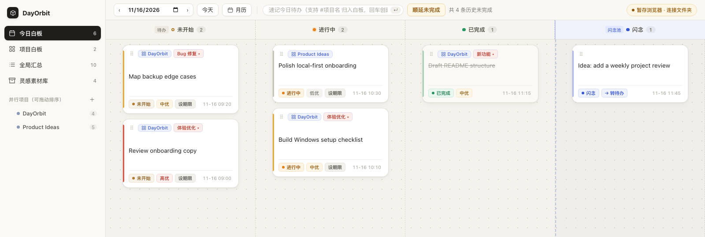
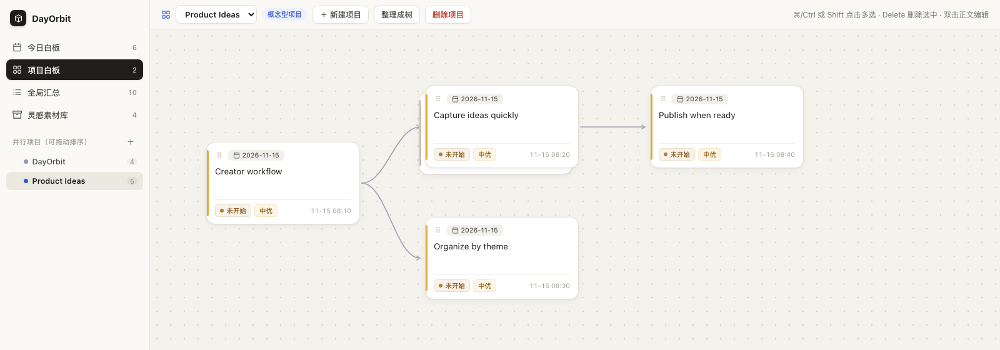
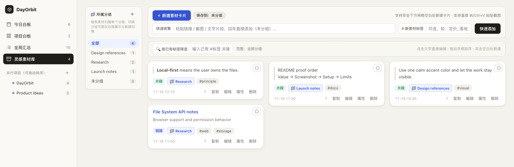
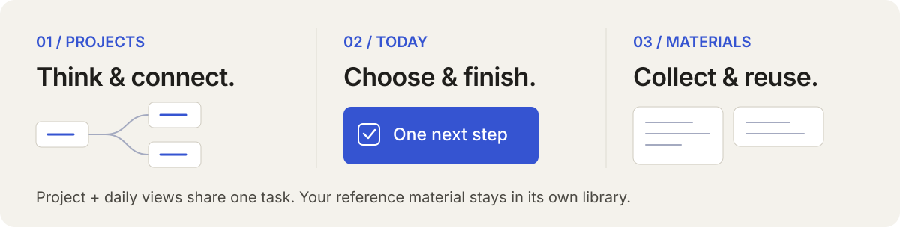

<p align="center">
  
</p>

<p align="center">
  <strong>Local-first · Plain Markdown &amp; JSON · No build step · MIT</strong>
</p>

<p align="center">
  <a href="#quick-start">Quick start</a> ·
  <a href="#how-the-views-connect">How it works</a> ·
  <a href="#data-and-backups">Data &amp; backups</a> ·
  <a href="#中文说明">中文说明</a>
</p>

**DayOrbit is a lightweight multi-project workbench for indie developers.** Keep each project moving on its own whiteboard, bring today's work into focus, and save useful references along the way.

## See your day clearly

Bring tasks from different projects into one daily board. Move them through **Not started → In progress → Done**, with a separate place for ideas.

<p align="center">
  <a href="./assets/readme/daily-board.png"></a>
</p>

> All screenshots show the actual app with synthetic demo data. These views crop empty canvas space; click an image for the full capture. No personal workspace data is included.

## Keep the whole project in view

Use a free canvas to explore a project, connect parent and child cards, and turn a loose idea into a useful structure. Development projects can use dedicated areas for bugs, experience improvements, and new features.

<p align="center">
  <a href="./assets/readme/project-whiteboard.png"></a>
</p>

## Save what you'll use again

Collect notes, links, images, and references in a grouped material library, ready to reuse across projects.

<p align="center">
  <a href="./assets/readme/material-library.png"></a>
</p>

## How the views connect

<p align="center">
  
</p>

A task on a project whiteboard and its daily card are **the same record**. Update its progress in either view without maintaining a second copy. Reference materials have their own records in the library.

Your data stays in readable Markdown and JSON files in a folder you choose. No account, telemetry, or cloud backend.

## Quick start

### Before you start

- **Browser:** desktop Chrome or Edge with the File System Access API.
- **Runtime:** Python 3.9 or newer, used only for the local static server.
- **System:** macOS, or Windows 10/11 with the included launcher.

The interface is currently Chinese-first. Firefox and Safari do not support the folder access DayOrbit relies on. The Windows launcher and Ctrl-based shortcuts have code-level coverage; broader physical Windows testing is still in progress.

### macOS

```bash
git clone https://github.com/nearKaFuKa/DayOrbit.git
cd DayOrbit
chmod +x scripts/start-macos.command
./scripts/start-macos.command
```

The launcher starts the local server when needed and opens <http://127.0.0.1:8765/>.

### Windows

Clone or download the repository, then double-click:

```text
scripts\start-windows.bat
```

Open <http://127.0.0.1:8765/> if the browser does not open automatically.

<details>
<summary>Start the server manually or at macOS login</summary>

On macOS:

```bash
python3 src/workbench-server.py
```

On Windows:

```bat
python src\workbench-server.py
```

Then open <http://127.0.0.1:8765/>. An optional launchd example is available at [`scripts/local.workbench.server.example.plist`](./scripts/local.workbench.server.example.plist).

</details>

### Connect a folder and make it yours

1. Create an **empty folder** for your DayOrbit data.
2. In the app, choose **连接存储文件夹** and grant read/write access. DayOrbit creates `灵感/`, `白板/`, and `素材/` on first use.
3. Add your first card and create a project whiteboard when you need one.
4. Optionally use Chrome or Edge's install control to open DayOrbit in a standalone app window.

Folder permission persistence is controlled by the browser. DayOrbit remembers the directory handle, but a restart or permission change may still require you to reconnect. Use the localhost server rather than opening the HTML file directly.

## Data and backups

**Your folder is the portable copy to back up.** It stays readable without DayOrbit and can be opened in Obsidian.

```text
Your DayOrbit folder/
├── 灵感/
│   ├── YYYY-MM-DD.md        # daily cards, one file per day
│   └── _links.json          # project whiteboard parent-child links
├── 白板/
│   └── <project>.md         # project indexes with card references
└── 素材/
    ├── mat-<id>.md          # one material record per file
    ├── _groups.json         # material group names
    └── assets/              # pasted images and other binary assets
```

Back up the whole folder. Browser `localStorage` is a local mirror used for resilience and startup merging; it does not replace that backup. The directory handle is stored in IndexedDB.

**Avoid editing the same synchronized data folder from multiple devices at once.** DayOrbit protects against two editing windows in the same browser, but has no cross-browser or cross-device lock. Daily files are rewritten as a unit, so concurrent sync clients can overwrite one another or create conflict copies.

## Security and privacy

- Workspace data stays in your selected folder and browser storage. DayOrbit has no telemetry or cloud sync.
- The Python server binds to `127.0.0.1`, serves only allowlisted app files, and disables directory listing. It does not receive your workspace data.
- Rich text uses a small formatting whitelist.
- Keep personal data folders, environment files, logs, and private screenshots out of contributions. Use synthetic fixtures and screenshots.

Review Markdown or JSON from untrusted sources before granting write access. DayOrbit is a personal local tool and is not designed as a sandbox for hostile files.

## Known limitations

- Desktop Chrome or Edge is required; Firefox and Safari are not supported.
- The interface is currently Chinese-first.
- Undo history stays in memory for the current session, up to the existing history limit.
- There is no cross-device conflict resolution or shared multi-user editing.
- Windows has launch scripts and keyboard handling, with broader real-device testing still incomplete.
- Direct `file://` use can display the app, but folder authorization is less reliable than localhost.

## Under the hood

DayOrbit has **no framework, build step, npm runtime dependency, or CDN**. The page talks directly to your chosen folder through the browser's File System Access API.

<details>
<summary>Architecture and development checks</summary>

| Part | Role |
| --- | --- |
| `工作台.html` | Main UI, interactions, storage orchestration, and styles |
| `src/workbench-core.js` | Pure data, layout, merge, validation, and sanitization helpers |
| `src/workbench-window.js` | Single-editor-window coordination with Web Locks and a local lease fallback |
| `src/workbench-server.py` | Loopback-only static server with an explicit file allowlist |
| `tests/` | Node regression tests and optional Playwright browser checks |

Run from the repository root:

```bash
node --check src/workbench-core.js
node --check src/workbench-window.js
node --test tests/workbench-core.test.js tests/workbench-window.test.js tests/workbench-storage.test.js
node -e 'const h=require("fs").readFileSync("工作台.html","utf8");const m=h.match(/<script>([\s\S]*?)<\/script>/);if(!m)throw Error("inline script missing");new Function(m[1]);'
```

The Python scripts under `tests/` require Playwright and Chromium. They stay outside the dependency-free default path.

</details>

## 中文说明

**多个项目持续运转，每天聚焦当下。** DayOrbit 是一款面向独立开发者的轻量级多项目工作台：项目白板梳理每个项目，今日白板聚焦当天任务，灵感素材库沉淀可复用的想法和参考资料。同一任务在项目白板和今日白板中是同一条记录，无需重复维护。

数据以 Markdown / JSON 保存在你授权的文件夹中，可直接备份，也可以用 Obsidian 阅读。没有账号、云端后端或遥测。

macOS 运行 `scripts/start-macos.command`，Windows 双击 `scripts\start-windows.bat`。推荐在桌面版 Chrome 或 Edge 中打开，并可安装为独立应用。首次使用时，新建空文件夹并点击「连接存储文件夹」；浏览器重启或权限变化后可能需要重新授权。

当前界面以中文为主，不支持跨设备冲突解决。Windows 已具备启动脚本与代码级兼容，更多真实设备验收仍在进行中。

## Contributing

Found a rough edge or have an idea? [Open an issue](https://github.com/nearKaFuKa/DayOrbit/issues) or read [CONTRIBUTING.md](./CONTRIBUTING.md) before submitting a pull request. Use synthetic data in examples and screenshots.

## License

[MIT](./LICENSE) © 2026 nearKaFuKa
